  
  
  
  

### Hello, I'm Sushmita.

I'm an **Artificial Intelligence & Machine Learning** undergraduate at **Aditya Engineering College** with a **9.10 CGPA**, and I build software end to end: the model, the API, the database and the interface someone actually touches.

A year of full-stack training at Technical Hub taught me to carry an idea from interface to server logic to deployment. Alongside it, I shipped an LLM-powered policy analyser, a UPI & card payment gateway, and a multi-tenant SaaS platform, each one containerised and built for someone other than me to run.

Java is my primary language and Python is where my ML work lives. I care about systems that hold up: payments that settle in exactly one state, tenants that never see each other's data, and AI whose answers can be checked against the source.

- 🎓 **Studying**: B.Tech, AI & ML, Aditya Engineering College (2023 – present)
- 🛠️ **Trained**: Full-Stack Development Trainee, Technical Hub Pvt Ltd (May 2025 – Jun 2026)
- 🔭 **Drawn to**: System design, cloud computing (AWS), machine learning

### Recognition

- 🏆 **Flipkart GRiD 7.0**: National Semi-Finalist
- 🏆 **Myntra WeForShe HackerRamp 2026**: Top 100 Team, for [StarCloset](https://github.com/Sushmitadasari/weforshe-starcloset)
- 🧮 **Problem solving**: 1,200+ problems across [LeetCode](https://leetcode.com/u/sushmita_dasari/) (400+, peak rating 1321), GeeksforGeeks (400+, rating 1464) and CodeChef (415+) · HackerRank 5★ in C, Python and Java · solutions in [leetcode-DSA](https://github.com/Sushmitadasari/leetcode-DSA) and [GFG-ProblemSolving](https://github.com/Sushmitadasari/GFG-ProblemSolving)

### Selected work

**PolicyGuard AI** · Python, NLP, LLM, REST API 
An AI-powered policy analysis platform across web, browser extension, mobile and desktop. I built LLM-based Q&A, key-information extraction and REST API integration for 10+ document types across 8 policy categories, cutting decision turnaround time by 45%. 
Source code is not public.

**Payment Gateway System** · Node.js, Express, PostgreSQL, React, Docker 
A Razorpay-style gateway: merchants create orders through API key & secret authentication, customers pay by UPI or card on a hosted checkout with Luhn and expiry validation, and a merchant dashboard tracks every transaction. A Dockerised microservice setup cut deployment setup by 70%, and backend optimisation reduced API response time by 40%. 
[Repository](https://github.com/Sushmitadasari/Payment-gateway-system-Project) · [Architecture walkthrough](https://www.youtube.com/watch?v=FUOZyQT5fNI)

**StarCloset · Myntra Bharat AI** · React 19, TypeScript, Go, PostgreSQL, Redis, optional Gemini 
Our team's Myntra WeForShe HackerRamp 2026 entry, which placed in the Top 100. It's a fashion assistant built on a rule-based, five-stage recommendation pipeline (Understand → Retrieve → Score → Diversify → Explain) that can explain every ranking. It understands occasions like *shaadi*, *sangeet* and *garba*, and keeps working with no LLM key configured. 
[Live demo](https://myntra-ai.vercel.app) · [Repository](https://github.com/Sushmitadasari/weforshe-starcloset)

**Multi-Tenant SaaS Platform** · Node.js, React, PostgreSQL, Docker Compose 
A project-governance platform built on shared-database multi-tenancy. Every query is scoped by `tenant_id` through middleware, with four-level JWT/RBAC: zero unauthorised-access incidents across 200+ users. One-command Docker Compose deployment took environment setup from 45 minutes to under 2. 
[Repository](https://github.com/Sushmitadasari/Multi-Tenant-SaaS-Platform)

### Toolkit

Plain-text stack

- **Languages**: Java (primary), Python, C, C++
- **AI · ML · LLM**: LLM integration, NLP, Machine Learning, Deep Learning
- **Frontend**: React, JavaScript, HTML, CSS
- **Backend & APIs**: Node.js, Express.js, REST APIs, Microservices, JWT auth
- **Data & infrastructure**: PostgreSQL, MongoDB, MySQL, Docker, Docker Compose, AWS
- **Tools & fundamentals**: Git, GitHub, Postman · DSA, OS, CN, DBMS, OOP, Multithreading

### Commit log

  

The heatmap is drawn from my real public GitHub contribution calendar and re-rendered daily by a GitHub Action ([build script](scripts/build-heatmap-svg.mjs)). No tokens or sample data are used. The stats card is served live by github-readme-stats.

### Certifications

- **AWS**: Certified AI Practitioner · AWS Academy Graduate, Cloud Foundations
- **MongoDB**: Certified Associate Developer · **GitHub**: Foundations · **Pearson**: IT Specialist, HTML and CSS
- **Oracle**: Java Certified Foundations Associate · Certified Foundations Associate, Database
- **NPTEL**: Database Management System · Fundamentals of Artificial Intelligence · Deep Learning
- **Cisco**: HTML, CSS, JavaScript 1 & 2, Python 1 Essentials · **Udemy**: Microsoft Azure Hands-On (AZ-900, AZ-104, AZ-305)

### Let's connect

Have a problem worth solving, or want to talk AI products and backend systems? Reach me at **[sushmitadasari17@gmail.com](mailto:sushmitadasari17@gmail.com)**, on **[LinkedIn](https://www.linkedin.com/in/sushmita-dasari-227a40284/)** and **[LeetCode](https://leetcode.com/u/sushmita_dasari/)**, or browse the full **[portfolio](https://sushmitadasari.github.io/Sushmitadasari/)** and **[video portfolio](https://videoportfolio-kohl.vercel.app/)**.

